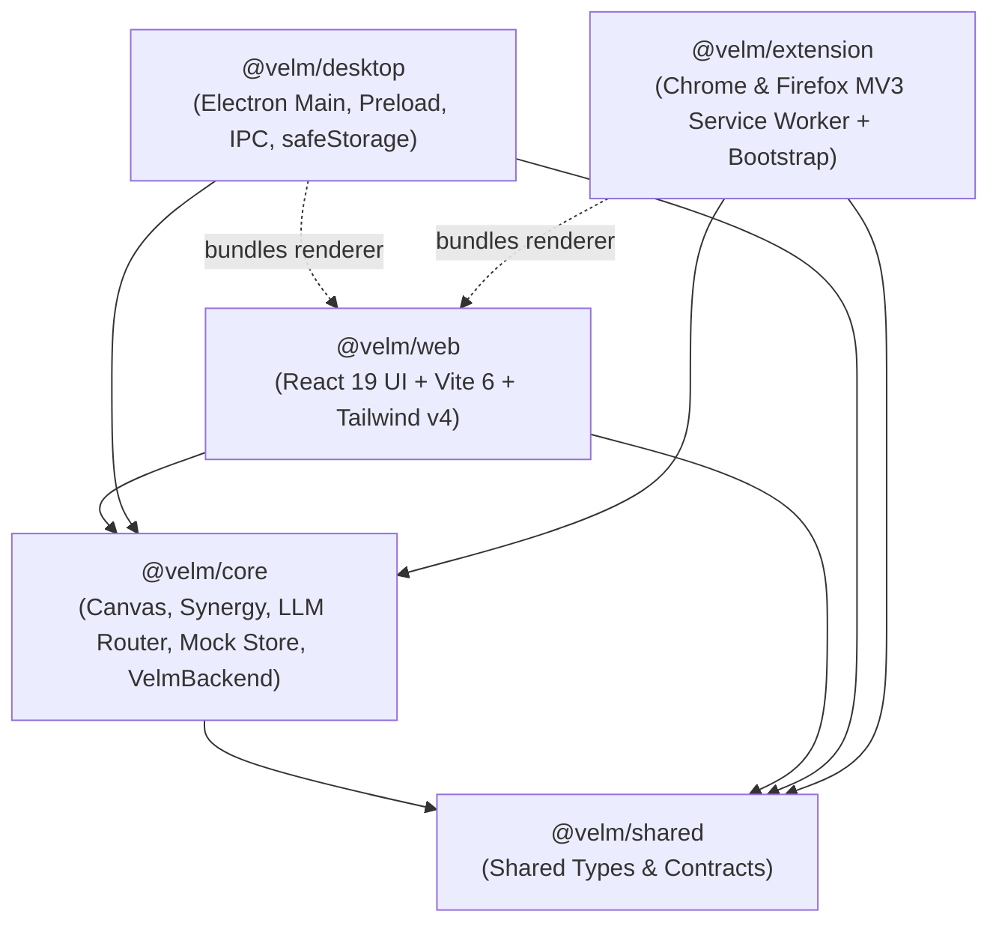

# Velm Architecture & Design

This document describes the technical architecture of Velm's local-first TypeScript port, covering the monorepo layout, runtime boundaries, school API integrations, routable LLM provider layer, security model, and offline mock datastore.

---

## 1. Monorepo Package Graph

- **`packages/shared` (`@velm/shared`)**: Cross-runtime types, error codes, and shared schemas.
- **`packages/core` (`@velm/core`)**: Pure, isomorphic TypeScript business logic with zero DOM or Node-only assumptions (injects `HttpTransport` and `SecretStore` per runtime):
  - `src/synergy/`: Edupoint Synergy SOAP client (`PXPCommunication.asmx`), Badgerfish XML-to-JSON parity, PXP2 HTML/JS web fallback, open-tab SSO reuse, and `SynergyService`.
  - `src/canvas/`: Isomorphic `CanvasHttpClient` with RFC 5988 `Link` header pagination and retries.
  - `src/llm/`: Routable `LlmRouter` supporting local servers, BYO cloud keys, reputable free tiers, Chrome Built-in AI, and PII redaction.
  - `src/mock/`: `VelmMockDatastoreV1` Zod schema, PII sanitizer, one-time account downloader, and offline replay `VelmBackend`.
  - `src/backend.ts`: Unified `VelmBackend` RPC interface and `createLocalBackend(...)` factory.
- **`apps/web` (`@velm/web`)**: React 19 UI built with Vite (`base: './'`) and build-time Tailwind v4 + self-hosted Inter fonts (zero remote CDN scripts or inline `<script>` tags so it passes strict MV3 CSP).
- **`apps/desktop` (`@velm/desktop`)**: Electron 35 shell wrapping `apps/web/dist` with sandboxed preload IPC (`preload.cjs` ~2.1 KB), OS keychain `safeStorage`, and per-student `persist:svue-<id>` cookie partitions.
- **`apps/extension` (`@velm/extension`)**: Chrome and Firefox MV3 extension wrapping `apps/web/dist`, injecting `bootstrap.js` via `<script type="module" src="./bootstrap.js">` before the React entry point.

---

## 2. Unified `VelmBackend` RPC & Fetch Bridge

The React UI does not branch on Electron vs. Chrome Extension vs. Offline Mock in feature components. Instead, each runtime mounts an implementation of `VelmBackend` on `window.__VELM_BACKEND__` and calls `installLocalBackendFetchBridge(backend)`:

- **Electron (`apps/desktop`)**: `preload.ts` exposes a narrow `contextBridge` proxy over Zod-validated `ipcMain.handle` channels (`apps/desktop/src/channels.ts` + `ipc.ts`). All outbound HTTP happens in the main process via Electron `net.fetch` (`electron-transport.ts`).
- **Browser Extension (`apps/extension`)**: `bootstrap.ts` constructs `createLocalBackend(...)` with `browser-transport.ts` (`fetch` with `credentials: 'include'`), `chrome-secret-store.ts` (WebCrypto AES-GCM backed by `chrome.storage.local`), and optional Chrome Built-in AI (`chrome-builtin-ai.ts`).
- **Offline Mock Mode**: `loadMockDatastoreJson(...)` validates a `VelmMockDatastoreV1` JSON file and mounts `createMockDatastoreBackend(store)` directly onto the fetch bridge.
- **Hosted Web Fallback**: When `window.__VELM_BACKEND__` is absent, `/api/proxy` and `/api/health` pass through to the Express dev/demo server (`apps/web/server.ts`).

`installLocalBackendFetchBridge` intercepts `/api/health` and `/api/proxy?url=...` in `window.fetch` and routes them through `backend.httpRequest(...)`, keeping existing Canvas service code unchanged across all runtimes.

---

## 3. Synergy (StudentVUE / ParentVUE) Integration

Ported directly from the Python `schoolview-api` and `studentvue` reference implementations into `packages/core/src/synergy/`:

1. **Primary SOAP path**: Calls `https://<district>/Service/PXPCommunication.asmx` with XML SOAP envelopes (`StudentInfo`, `Gradebook`, `Attendance`, `Calendar`, `Messages`, `StudentClassList`, `Documents`, `SchoolInfo`, `ReportCards`) and converts responses to Badgerfish JSON for 100% parity with existing UI parsers.
2. **PXP2 Web Fallback**: For districts where SOAP is restricted or returns incomplete data, falls back to PXP2 HTML/JS endpoints (`PXP2_Login_Student.aspx` / `PXP2_Login_Parent.aspx`, `PXP2_Gradebook.aspx`) parsed with `cheerio`.
3. **Open-Tab SSO Reuse (Browser Extensions)**: When `reuseExistingSession: true` is enabled in the Verify or Grade Sync modals, requests run with `credentials: 'include'` using the user's already-authenticated browser tab cookies for SSO districts (Google, Microsoft, Clever) without needing a password.

---

## 4. Routable AI Provider Layer (`LlmRouter`)

Located in `packages/core/src/llm/`:

- **Off by Default**: No AI provider is called until the user explicitly configures one in `AiProviderSettingsModal`.
- **Provider Tiers**:
  1. **Local / On-Device (Highest Privacy)**: Auto-discovery of Ollama (`127.0.0.1:11434`), LM Studio (`127.0.0.1:1234`), llama.cpp (`127.0.0.1:8080`), and Chrome Built-in AI (`window.ai` / `LanguageModel`).
  2. **Bring Your Own Cloud Key**: OpenAI, Anthropic, Google Gemini, OpenRouter, Mistral, or any OpenAI-compatible endpoint.
  3. **Reputable Free Tiers**: Groq, GitHub Models, and OpenRouter `:free` models (requires user's own free account key).
  4. **Privacy-Unfriendly Endpoints (Decision D11)**: Disabled by default (`allowPrivacyUnfriendlyEndpoints: false`), while keeping routing support in code for potential future opt-in.
- **Data Minimization**: Enabled by default (`getLlmMinimizeStudentData() === true`), redacting emails, student IDs, and phone numbers before prompts leave the device.

---

## 5. Security, Privacy & Isolation Model

- **Zero Velm Cloud**: All Canvas, Synergy, and AI traffic travels directly from the user's device to the chosen endpoints.
- **Electron Hardening**: `contextIsolation: true`, `nodeIntegration: false`, `sandbox: true`, strict navigation/new-window blocking, and Zod validation on every IPC payload.
- **Secret Storage**:
  - Desktop: OS Keychain / DPAPI / Secret Service via Electron `safeStorage`.
  - Extensions: Random per-install AES-256-GCM key stored in `chrome.storage.local` (never written to `localStorage` in plaintext).
  - StudentVUE passwords are kept strictly transient in memory and cleared on modal close.
- **Multi-Student Cookie Isolation (Decision D4)**:
  - **Desktop**: Each student profile gets an isolated Electron session partition (`persist:svue-<accountId>`), allowing multiple siblings in one app window.
  - **Chrome / Firefox Extensions**: Browser extensions share a single cookie jar per browser profile, so `multiStudentSupported` is `false` and the UI guides users to use a separate browser profile per student.
- **Unsigned Builds (Decisions D6, D8)**: Desktop installers and unpacked extension zips are currently unsigned; every release includes `SHA256SUMS.txt`, `docs/GETTING_STARTED.md`, and an in-app `LocalFirstRunModal` security notice.

---

## 6. Offline Mock Datastore (`VelmMockDatastoreV1`)

Located in `packages/core/src/mock/`:

- **Schema (`schema.ts`)**: Versioned Zod schema capturing all Canvas endpoints (`self`, `profile`, `courses`, `courseNicknames`, `todo`, `upcomingEvents`, `announcements`, per-course details/enrollments/assignments/groups/modules) and all Synergy operations (`student_info`, `gradebook`, `attendance`, etc.).
- **One-Time Account Downloader (`downloader.ts` + `scripts/download-mock-data.ts`)**: Scrapes a real account once using interactive masked prompts (or CLI flags), optionally scrubs PII via `sanitize.ts` (deterministic pseudonymization of names, emails, IDs, and domains), and writes `velm-mock-store.v1.json` (gitignored).
- **Replay Backend (`replay-backend.ts`)**: Implements `VelmBackend` against the JSON snapshot so the entire app can be tested and demonstrated offline with realistic data.
